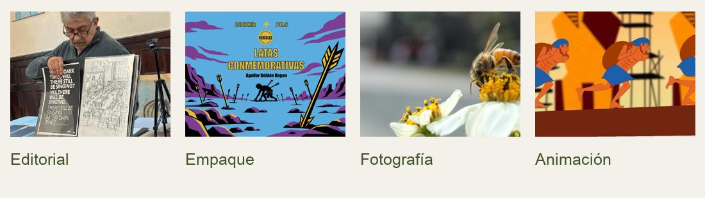

# Arquitectura del CV digital

## Presentación y recorrido

Organizo mi CV en una página. El menú recorre Hola, Sobre mí, Proyectos, Experiencia, Educación, Habilidades y Contacto. La barra superior permanece visible. El monograma HAR abre y cierra el índice. Elegir una sección o pulsar Escape también lo cierra.

### Primera pantalla

Distribuyo siete columnas para la presentación y cinco para el retrato. Mi nombre encabeza la página, seguido de «Diseñador gráfico y digital en formación» y «Diseño para estar al servicio de las personas y mejorar su entorno». El botón «Conoce mi trabajo» lleva a las cuatro tarjetas. «Contáctame» lleva al correo y al teléfono.

### Sobre mí

Soy Hagen Aguilar Roldán, vivo en la Ciudad de México y actualmente me formo como diseñador gráfico y digital. Mi principal interés está en la animación, acompañado del modelado 3D, el diseño digital y la creación de propuestas visuales que combinen creatividad y funcionalidad. También me interesa la fotografía, la ilustración, viajar y explorar nuevos lugares, experiencias y formas de expresión

### Color y jerarquía

Uso marfil #F4F1EA para la página, negro #111111 para lectura y oliva #3F5228 para acciones. El terracota #D8492E marca la sección activa. En contacto invierto la combinación y escribo en marfil sobre oliva.

Cinzel 500 abre la portada a 64/72 px y Cinzel 400 abre las secciones a 40/48 px. Fira Sans 600 identifica las fichas a 24/30 px, 400 sostiene el cuerpo a 18/27 px y 500 distingue acciones a 16/24 px. El sitio utiliza cuatro archivos WOFF2 locales.

## Proyectos

Después de Sobre mí, muestro cuatro tarjetas en dos columnas. Cada una presenta su portada en un marco 4:3, la disciplina, el nombre del trabajo y la acción. En móvil cada ficha ocupa el ancho disponible.

### Editorial

«Abrir publicación» abre el PDF de Línea Azul. La portada muestra una escena del trabajo editorial.

### Empaque

«Abrir presentación» abre el PDF de Latas conmemorativas, donde se puede recorrer la propuesta completa.

### Fotografía

«Ver 2 fotografías» abre un carrusel manual. Se muestra una imagen completa a la vez, con pie, contador y controles Anterior y Siguiente. Las flechas del teclado permiten recorrer la serie.

### Animación

«Ver animación» abre la pieza MP4 en un reproductor con controles de reproducción, volumen y avance. La reproducción comienza cuando la persona lo decide.

Al pasar el cursor, subrayo el título y elevo la tarjeta con una sombra de 0 8px 24px al 6 % de negro. Un clic o toque abre el archivo o visor. Con teclado, Tab marca la tarjeta con un contorno oliva y Enter la abre. Cerrar el visor devuelve el foco a la tarjeta.

## Trayectoria y educación

Presento las experiencias en orden cronológico inverso. El puesto o reconocimiento se lee primero, seguido de institución, fecha y contribución. Una marca terracota y el texto del premio distinguen los reconocimientos.

### Taller Vertical de Vinculación 2026 — Segundo lugar

Universidad La Salle México, septiembre de 2026. Participé en el desarrollo de una propuesta de aplicación y página web para Itaso MX, trabajando en la conceptualización, wireframes, pantallas y flujos de interacción para apoyar a cuidadores de niños en la comprensión de información alimentaria.

### Premio A Diseño 2025 — Mención Plata en Empaque

Revista A Diseño, reconocimiento en julio de 2026. Colaboré en el desarrollo creativo de una propuesta de empaque, la producción y postproducción de imágenes de producto y el refinamiento de ilustraciones para su presentación final.

### Summer Work & Travel 2025

Universal Orlando Resort, Orlando, Estados Unidos, mayo a agosto de 2025. Trabajé en el área de alimentos y bebidas, realizando atención al visitante, preparación de pedidos y actividades operativas. Esta experiencia fortaleció mi comunicación, adaptación, colaboración y capacidad para trabajar bajo presión en un entorno internacional.

### 1.er Concurso de Playeras Estampando Ideas 2024

Universidad La Salle México, mayo de 2024. Desarrollé una propuesta gráfica a partir de la investigación y conceptualización visual, explorando composiciones, tipografías y técnicas de impresión textil para su aplicación sobre una prenda.

### Educación

Universidad La Salle · Licenciatura en Diseño Gráfico y Digital. Curso el 7.º semestre, con promedio de 8.15/10.

Formación autodidacta · Aprendizaje complementario en modelado 3D, animación y fotografía.

## Habilidades y contacto

- **Fotografía.** Producción fotográfica, composición, retoque y tratamiento de imagen.
- **Idiomas.** Español nativo, inglés con competencia profesional y francés básico.
- **Trabajo en equipo.** Colaboración, comunicación y adaptación en proyectos y entornos diversos.
- **Herramientas Adobe.** Manejo de Illustrator, Photoshop, Camera Raw, Lightroom, After Effects e InDesign.
- **Diseño de identidad.** Conceptualización visual y desarrollo de sistemas gráficos.
- **Animación.** Interés y formación en animación y comunicación visual en movimiento.
- **Modelado 3D.** Exploración de volúmenes, construcción de modelos y representación tridimensional.
- **Ilustración.** Desarrollo de recursos gráficos y propuestas visuales.

### Contacto y cierre

«¿Tienes un proyecto en mente? Hablemos». El correo hagen.aguilar.r@gmail.com abre la aplicación de correo. El teléfono +52 55 3125 8193 inicia una llamada. GitHub queda pendiente de una dirección confirmada.

Cierro con «Hoy... mejor que ayer y mañana mejor que hoy», acompañado del monograma, mi nombre y el año. «Contáctame» vuelve al bloque de contacto y «Sistema de diseño» abre la guía de HAR.

### Proporciones y espaciado

Centro el contenido en 1240 px. A partir de 1440 px uso 12 columnas, márgenes de referencia de 72–96 px y 108–144 px entre secciones. De 1024 a 1439 px conservo las 12 columnas y reduzco los márgenes a 48–64 px.

En tableta utilizo 8 columnas, márgenes de 32 px y pausas de 72 px. En móvil uso 4 columnas con un flujo principal, márgenes de 16–20 px y pausas de 48–60 px. El título baja a 40/48 px, las secciones a 28/36 px y el cuerpo a 16/24 px.

Las tarjetas tienen radio de 4 px y espacio interior de 36 px, reducido a 20 px en móvil. Los controles tienen un área mínima de 44 × 44 px. Mantengo visibles sus acciones en pantallas táctiles.
